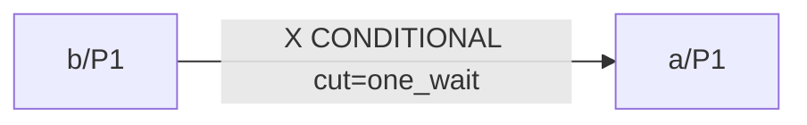
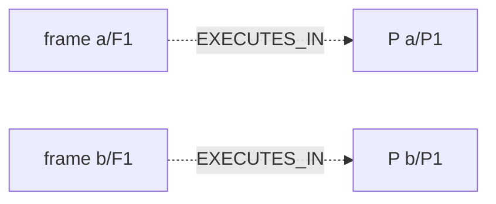

# Conditional wait dependency scenario

NO_CYCLE_IN_MODELED_SCENARIO

Coverage: INCOMPLETE. Runtime: NOT RUN. Global risk absence: NOT ASSERTED.

Inputs are referenced by exact-byte SHA-256; embedded T01 uses the documented canonical JSON digest.

## Application graph

```mermaid
%% Application completion graph
%% CONDITIONAL only. Arrows are waiter -> blocker (or caller -> callee).
flowchart LR
```

## Cut one_wait

NO_CYCLE_IN_MODELED_SCENARIO




## Obligations

- W1 / one_wait: a2 -> a1 — EXCLUDED
  - W1 CONTRADICTED: Distinct identified P; live at cut; waiter current and unsuspended. Premises:
  - W2 EXPLICIT_ASSUMPTION: Common database, effective datasource and JDBC enlistment explicitly assumed. Premises: a2_binding, a1_binding
  - W3 UNKNOWN: Object and opaque lock target overlap are separate explicit premises; granularity remains bounded/UNKNOWN. Premises:
  - W4 EXPLICIT_ASSUMPTION: Waiter request, prior holder acquisition and retention have separate provenance. Premises: a2_request, a1_request, a1_acquire, a1_retain
  - W5 EXPLICIT_ASSUMPTION: Versioned abstract incompatible modes and blocking (not NOWAIT/skip/retry). Premises: blocking
  - W6 EXPLICIT_ASSUMPTION: Pending waiter at invocation; holder acquisition precedes cut and is retained, not inferred from L/SP/S. Premises: a1_retain
  - W7 UNKNOWN: Common explicit prefix cut with concurrent independent instances or live suspended outer/replacement. Premises: concurrent
  - W8 MODEL_EVIDENCE: Jointly compatible prefixes; no continuation beyond pending returns or unresolved frontiers. Premises:
- W2 / one_wait: b1 -> a1 — QUALIFIED
  - W1 MODEL_EVIDENCE: Distinct identified P; live at cut; waiter current and unsuspended. Premises:
  - W2 EXPLICIT_ASSUMPTION: Common database, effective datasource and JDBC enlistment explicitly assumed. Premises: b1_binding, a1_binding
  - W3 EXPLICIT_ASSUMPTION: Object and opaque lock target overlap are separate explicit premises; granularity remains bounded/UNKNOWN. Premises: X_database, X_object, X_overlap
  - W4 EXPLICIT_ASSUMPTION: Waiter request, prior holder acquisition and retention have separate provenance. Premises: b1_request, a1_request, a1_acquire, a1_retain
  - W5 EXPLICIT_ASSUMPTION: Versioned abstract incompatible modes and blocking (not NOWAIT/skip/retry). Premises: blocking
  - W6 EXPLICIT_ASSUMPTION: Pending waiter at invocation; holder acquisition precedes cut and is retained, not inferred from L/SP/S. Premises: a1_retain
  - W7 EXPLICIT_ASSUMPTION: Common explicit prefix cut with concurrent independent instances or live suspended outer/replacement. Premises: concurrent, independent_b, independent_a
  - W8 MODEL_EVIDENCE: Jointly compatible prefixes; no continuation beyond pending returns or unresolved frontiers. Premises:

## Coverage and limits

- UNRESOLVED_DATA_OR_CAUSALITY
- Conditional static scenario only; execution, locks and waits are not observed.
- Opaque targets and abstract compatibility are explicit scenario assumptions.
- No JDBC wiring, SQL target resolution, runtime adapter or schedule enumeration.
- NO_CYCLE_IN_MODELED_SCENARIO applies only to the modeled scope and cut(s).
- No conclusion of general risk absence, deadlock freedom, commit or rollback.
- Input digests establish byte identity, not external source authenticity.

## Typed cross-layer links



