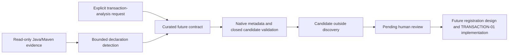

# MANA-META-SKILL-00 — Skill Factory Foundation

## Status

`ready_with_warnings` for the bounded candidate-generation foundation.
Date: 2026-10-19. Human approval of generated skills remains pending.
Transaction analysis: NOT IMPLEMENTED; execution: BLOCKED.

## Executive Summary

Mana can generate and validate a native specialist skill candidate from observed
Java sources and direct Spring Maven dependency declarations. The candidate
contains the requested future transaction contract, limitations, tools and
verification criteria. It stays generated, untrusted, unregistered and
non-executable; the factory offers only `generate` and `validate`.

Preflight verified `/Users/zel/projects/mana`, clean `develop`, HEAD
`ad8730ebe70f494ac24a80fbf32fcf2b30cdef35`. Implementation is on
`feature/mana-meta-skill-00` in the existing checkout. No new worktree,
Familiar changes, merge or push was performed. Changes are delivered uncommitted.

## Decision Table

| Requirement | Result | Evidence / scope |
|---|---|---|
| Technology detection from verifiable evidence | PASS | Direct dependency coordinates plus same-module Java file and SHA-256 values |
| Structurally valid native candidate | PASS | Existing skill metadata and output validators in isolation |
| Unsupported/unproven technology rejection | PASS | Focused negative cases: false coordinates, comments, descriptions, parent/managed/test-only dependencies, Gradle, absent Java |
| No automatic activation or trust | PASS | Candidate outside discovery, exact pending/generated state; native compiler rejects candidate request |
| Analyzed project unchanged | PASS | Test snapshots and real PetClinic before/after content and Git state |
| Transaction analysis / diagrams | NOT IMPLEMENTED | Future contract only; all six future capabilities remain `not_implemented` |
| Candidate registration, activation, human approval | BLOCKED | No promotion API; pending human review and missing analyzers |
| Full zero-token suite / remote CI | NOT RUN | Focused local verification only; test added to existing suite and CI |

## Findings

### Architectural Reconnaissance

The existing extension points are native `skills/*/SKILL.md` metadata,
`scripts/validate-skills.sh`, `scripts/build-skill-index.sh`, the generated
`skills/index.yaml`, and authoritative profile compilation in
`scripts/mana-compile-profile.sh` / `scripts/lib/context-runtime.py`.
Only the new factory is indexed. No existing profile is expanded and no candidate
is placed in the active skill tree.

Existing instruction/output conventions come from
`docs/standards/agent-skill-output-standard.md` and templates. The factory uses
one curated template and a closed manifest; repository text is evidence, never
injected instructions. Generic Codex skill metadata differs from Mana metadata,
so validation uses the existing Mana validators.

Governance and least-privilege responsibilities are already defined in
`docs/architecture/skill-agent-mcp-model.md` and the output standard. Existing
learning reviews in `scripts/mana-learning.sh` and actions in
`scripts/mana-actions.py` do not provide skill registration or human approval.
They were not repurposed as a trust authority.

`scripts/run-profile-v2.sh` and `scripts/lib/provider-dispatch.sh` already route
provider execution. Deterministic generation needs no LLM, credentials or new
runner. Verification Skills already use `capability: verification`, sibling
contracts, `scripts/validate-verification-skills.sh`, `scripts/mana-verify.sh`
and `scripts/lib/verification.sh`. This candidate has no verification executable
contract. The existing execution policy forbids `generated` execution in v1.

### Limits

Supported detection is conventional Maven direct dependencies plus nonempty
UTF-8 `.java` files under the same module's `src/main/java/`. File presence is
not compilability. Gradle, inherited-only declarations, active profiles,
nonstandard roots and resolved versions are unsupported. Input inventory is
bounded; overflow blocks instead of accepting partial detection.

No parser/call graph, transactional-method detection, propagation computation,
transaction-manager inference, diagram rendering, runtime observation or external
source transfer is implemented. Template validation demonstrates structure and
provenance, not analysis quality. Stable-checkout filesystem checks do not provide
adversarial concurrent-filesystem isolation. The factory does not prevent manual
installation through unrelated tools; no supported promotion path is delivered.

## Evidence

Implementation and usage: [workflow](../workflow/specialist-skill-factory.md),
`scripts/mana-skill-factory.py`, `skills/specialist-skill-factory/SKILL.md`.

Real generated artifact:
[candidate SKILL.md](../examples/mana-meta-skill-00/java-spring-transaction-analysis/SKILL.md),
[candidate manifest](../examples/mana-meta-skill-00/java-spring-transaction-analysis/candidate.json),
[provenance](../examples/mana-meta-skill-00/provenance.json).
Source: existing local Spring PetClinic checkout at
`500158f732419217507c7656904b8e6aa1bcc0d6`.
Generation and revalidation exited 0. Across 132 files, before/after content
digest was identical:
`7cd602986575faa0589f0b9e2177c45ecd682ceae6fd97d04666c0da36b91851`.
Git HEAD stayed equal and porcelain status stayed empty. The snapshot excludes
`.git` internals and includes source/configuration file content; it is not a
filesystem metadata or runtime qualification claim.

Local commands and outcomes:

| Command | Result |
|---|---|
| `python3 tests/mana-skill-factory.py` | PASS: 12 focused tests |
| `scripts/validate-repo.sh` | PASS: includes native skill, verification-spec, output, index and repository checks |
| `tests/profile-skill-activation.sh` | PASS |
| `scripts/build-skill-index.sh` compared with `skills/index.yaml` | PASS |
| `git diff --check` | PASS |
| Ruff lint and formatting checks on the new Python implementation/tests | PASS |

The focused tests also reject stale evidence, duplicate JSON keys, candidate
content/tool/trust tampering, extra executable artifacts, output inside the target
or discovery paths, symlink evidence and output aliases, malformed/unsafe/oversized
descriptors and overwrite attempts. An executable Maven-wrapper sentinel stays
unexecuted. Tests are wired into existing CI and zero-token acceptance lists;
no new qualification infrastructure was introduced.

## Diagram

## Open Questions

TRANSACTION-01 must agree parser/dependency choices, supported versions and
transaction managers, static resolution boundaries, diagram renderer, and the
exact approved promotion handoff. These do not block candidate generation.

## Actions

Review the delivered candidate and
[TRANSACTION-01 proposal](../roadmap/TRANSACTION-01.md). Do not execute the
candidate. This delivery stops at the foundation; no analyzer work begins here.

## Human Approval

Architect / Team Leader approval is required before future registration or
activation. No approval was recorded, inferred or requested as a condition of
delivering this foundation. Approval alone cannot supply missing analyzers.
