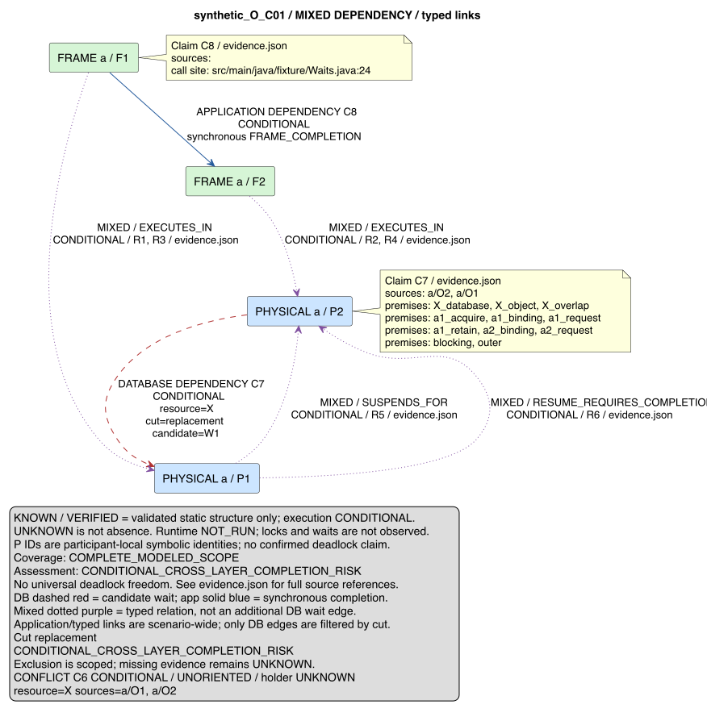

# MANA-TRANSACTION-01-VIS-01-R1

Verdetto: **NEEDS_FIX**. Data: 2026-10-23.

La proiezione semantica dei 14 esempi esaminati è coerente con T01/S01/S02.
Il gate visivo non passa: nella visualizzazione tramite librsvg dell'SVG C mixed
l'etichetta della relazione R6 è tagliata sul bordo destro. Il difetto è
riproducibile sul file consegnato, senza modificare sorgente o SVG. La stringa
completa è presente nell'XML: non è una perdita della relazione nel modello.
La valutazione negativa è limitata al percorso di visualizzazione effettivamente
eseguito; non si afferma che tutti i browser presentino lo stesso difetto.

Nessuna correzione automatica, staging, commit, switch, merge o push eseguiti.
Feature e develop restano entrambi ad
`a222018fa50a3e1286a01f6da6c224a4dea242ed`; indice vuoto.

## Indipendenza e metodo

Review svolta in questo contesto separato dall'implementazione. Il report VIS-01
è stato trattato come inventario e insieme di affermazioni da verificare, senza
assumere i suoi PASS come evidenze correnti. Nessuna delega al contesto autore.

Letti il report VIS-01, il contratto visualization-v1, il README degli esempi,
Transaction Model v1, Resource Timeline Model v1 e Wait Dependency Model v1.
Esaminati diff del renderer, CLI, test, 14 sorgenti PlantUML, i tre evidence.json,
report S02, sidecar e Timeline originali dei tre scenari. Verificati direttamente
proiezione, namespace, ordine eventi/operazioni, archi, claim e premesse.

Tutti i 14 SVG consegnati sono stati aperti mediante rasterizzazione **dei file
SVG effettivi** con `rsvg-convert --background-color=white` e ispezione delle
immagini risultanti. Non si tratta di PNG generati direttamente dal PlantUML.
Il fondo bianco evita che la trasparenza nasconda testo nero nel visualizzatore.
Dimensioni native: 588–1185 px in larghezza e 287–1602 px in altezza.
La verifica visiva copre testo, regioni, frecce, legende, premesse e associazioni,
non soltanto XML o presenza di stringhe.

Per un controllo aggiuntivo in browser, iab e Chrome hanno restituito
`Browser is not available`; Safari ha restituito errore di cattura `-3811`.
Questa verifica aggiuntiva è **non qualificata**. Nessuna conclusione sulle
metriche dei font o sul comportamento di questi browser è ricavata dai tentativi.

## R1-V01 — VISUAL_DEFECT, bloccante nel percorso librsvg

File interessati:

- [SVG originale](../examples/transaction-01-vis-01/C/mixed-replacement.svg)
- [Sorgente PlantUML](../examples/transaction-01-vis-01/C/mixed-replacement.puml)
- [Immagine effettivamente ispezionata](TRANSACTION-01-VIS-01-R1/C-mixed-replacement.png)

La relazione R6 corrisponde esattamente a
`evidence.json.relationRefs.R6`, tipo `RESUME_REQUIRES_COMPLETION`, da a/P1 ad
a/P2. Nel PNG la prima riga dell'etichetta, sul lato destro del grafo all'altezza
di circa 500 px, termina sul bordo prima di mostrare integralmente COMPLETION.
Questo viola il requisito di assenza di etichette tagliate proprio per la relazione
che spiega la dipendenza del ripristino dal completamento della transazione nuova.
L'evidenza JSON completa non sostituisce la leggibilità dell'etichetta grafica.

Riproduzione, dalla root del repository:

```sh
rsvg-convert --background-color=white \
  docs/examples/transaction-01-vis-01/C/mixed-replacement.svg \
  -o /private/tmp/mana-vis-r1-counterexample.png
```

Ambiente: librsvg/rsvg-convert 2.61.3, cairo 1.18.4, pango 1.57.0,
harfbuzz 14.3.1, fontconfig 2.18.3. SVG SHA-256:
`7c199e8586f5c481a94d8d3a82ea989faa4229850d91a6f4c373ed056282a796`.

L'XML contiene l'etichetta completa a x=607.99, y=503.3366,
`textLength=260.9331`, con viewport `0 0 876 889` e font `sans-serif` 13.
La lunghezza dichiarata nominalmente rientra nel viewport: non attribuisco quindi
il problema a un overflow geometrico dimostrato nell'XML. La causa tra metriche
del font e supporto del visualizzatore a `textLength/lengthAdjust` resta
**TOOL_LIMITATION / non isolata**. Il risultato visivo tagliato è invece osservato.
Una successiva review potrà qualificare una soluzione di presentazione o un
visualizzatore supportato con evidenza visiva completa. Questa review non cambia
renderer, layout, font o SVG per ottenere il PASS.



## Matrice dei 14 diagrammi

PASS semantico significa fedeltà alla struttura statica condizionale, non runtime.
PASS visivo è limitato all'immagine SVG rasterizzata con il percorso sopra.
Tutte le righe sono state ispezionate individualmente.

| Diagramma | Semantica | Visivo | Riscontro |
|---|---|---|---|
| A/application | PASS | PASS | Nessun arco applicativo qualificato; INCOMPLETE e runtime NOT_RUN presenti |
| A/database-common | PASS | PASS | a/P1→b/P1 su Y C11/W2; inverso su X C12/W3; ciclo solo condizionale |
| A/mixed-common | PASS | PASS | Frame separati da P; R1–R6 correlabili; due candidati DB tratteggiati |
| A/sequence-a | PASS | PASS | O1 WRITE X prima di O2 WRITE Y, entrambi P1; L1 distinto da P1 |
| A/sequence-b | PASS | PASS | O1 WRITE Y prima di O2 WRITE X; participant b distinto da a |
| B/application | PASS | PASS | Grafo senza archi applicativi; UNKNOWN e limite globale espliciti |
| B/database-one_wait | PASS | PASS | Solo b/P1→a/P1 su X; cut one_wait; esclusione locale, W1 contradicted e W3/W7 unknown |
| B/mixed-one_wait | PASS | PASS | Stesso unico arco DB; frame/P distinti, esclusione limitata al cut |
| B/sequence-a | PASS | PASS | X poi Y, context P1; esito qualificato e INCOMPLETE visibili |
| B/sequence-b | PASS | PASS | X poi Y, identità locale b/P1; nessun ordine globale tra pannelli |
| C/application | PASS | PASS | C8 F1→F2, completamento sincrono; nessun arco DB fabbricato |
| C/database-replacement | PASS | PASS | C7/W1 P2→P1, candidato su X nel cut replacement |
| C/mixed-replacement | PASS | **FAIL** | R6 completa nel JSON/XML ma tagliata nella visualizzazione librsvg: R1-V01 |
| C/sequence-a | PASS | PASS | P1 LIVE/SUSPENDED; P2 indipendente; fine P2, resume P1, fine P1 |

## Riscontri semantici

**Scenario A.** Le due transazioni sono a/P1 e b/P1, non una P1 condivisa.
Le sequenze mantengono gli ordini opposti X/Y e Y/X. I due archi DB conservano
claim, candidato, risorsa, cut e tutti gli ID delle premesse del claim. Le note
INCOMPLETE, CONDITIONAL e runtime NOT_RUN impediscono di interpretarli come lock
osservati o deadlock confermato. I conflitti C9/C10 sono UNORIENTED, holder UNKNOWN.

**Scenario B.** Un solo arco qualificato b/P1→a/P1, nel cut one_wait. Le viste DB e
mixed dichiarano esplicitamente il limite al cut e alle operazioni selezionate,
l'esclusione strutturale e la distinzione dalle premesse mancanti. Candidate W1
EXCLUDED non cancella W3/W7 UNKNOWN. Il report è validato con la proiezione S02
corrente; il formato pubblico v1 omette intenzionalmente i certificati interni
`exclusionProof` (`build_report`), quindi la loro assenza nel JSON pubblico non è
stata trattata come prova di errore. Non è una garanzia universale di deadlock freedom.

**Scenario C.** O1 WRITE X è attribuita a P1; O2 EXPLICIT_LOCK_REQUEST X a P2.
La sequenza mantiene SUSPEND S1/P1 (6), PHYSICAL_BEGIN P2 (7), fine L2 (10),
fine P2 con outcome UNKNOWN (11), RESUME_CONDITIONAL P1 (12), fine L1 (14),
fine P1 (15). P1 rimane viva nella sospensione, senza dedurre rilascio lock.
C8 è tra frame F1/F2, C7 è tra P2/P1. SUSPENDS_FOR e RESUME_REQUIRES_COMPLETION
sono relazioni tipizzate, non ulteriori attese DB. Il problema di R6 è visivo.

**Scope e lifetime.** I gruppi sono annidamenti di metodi; non sono rettangoli di
attività fisica continua. BEGIN/END, L/P/SP e note SUSPEND/RESUME definiscono le
transizioni. Questa notazione alternativa è esplicita e semanticamente accettabile.
I 14 casi non contengono un esempio NESTED né un join REQUIRED interno: questi
percorsi sono stati verificati nel codice e nei test mirati già previsti
(boundaries, physical-lifetime, context-alternatives e oracle savepoint VIS).
Non si dichiara un'ispezione visiva di ulteriori SVG NESTED non consegnati.
Le operazioni UNPLACED restano in appendice senza posizione temporale o P inventata.

## Provenance, sicurezza e determinismo

PASS sui tre insiemi: byte degli input verificati dai digest, scenario esplicito
uguale al sidecar del report, modello T01 incorporato validato, namespace completi
usati come chiavi degli alias. I nomi visuali abbreviati rimandano al JSON con
scenario, participant, digest e identità originale. `validatedS02` è esattamente
il report originale e Rn è esattamente `crossLayerRelations[n-1]`.

Due rendering degli stessi input producono identici sorgenti/evidence, senza
mutare gli oggetti. Tutti i sorgenti/evidence consegnati coincidono byte per byte
con la proiezione corrente. Rigenerati in directory temporanea i 14 SVG con
PlantUML locale: coincidono byte per byte con quelli consegnati.
Questo vale per l'ambiente locale, non tra versioni o font differenti.

Il renderer proietta archi esistenti e filtra i DB per cut; non unisce cut e non
calcola dipendenze nuove. La CLI non analizza Java, non invoca PlantUML o codice
target e riusa lettura bounded e pubblicazione esclusiva S02. Valori dinamici
sanitizzati con whitelist ASCII e alias interni; ID strutturali validati da S02.
Nessun include, hyperlink, direttiva o accesso di rete derivato dagli input nei
14 sorgenti. I test negativi verificano payload di injection e rifiuto di digest,
scenario e riferimenti alterati. Il report completo in JSON conserva valori
originali senza interpretarli come direttive. I digest provano coerenza, non
l'autenticità di una fonte esterna.

## Regressioni eseguite in R1

Tutte con exit 0; log e comandi in
[checks.json](TRANSACTION-01-VIS-01-R1/checks.json).

| Verifica | Risultato corrente |
|---|---|
| transaction-visualization | PASS, 13 test |
| transaction-boundaries | PASS, 16 test |
| transaction-physical-lifetime | PASS, 19 test |
| transaction-context-alternatives | PASS, 21 test |
| resource-timeline | PASS, 22 test |
| wait-dependencies | PASS, 22 test |
| Totale pacchetto richiesto VIS-01 | **113 PASS**, nessuno skip |
| mana-skill-factory | PASS, 23 test aggiuntivi di isolamento/governance |
| bash scripts/validate-repo.sh | PASS |
| Ruff check e format --check sui tre Python VIS | PASS |
| PlantUML 1.2024.8 -checkonly e -tsvg | PASS, 14 sorgenti e 14 SVG |
| Controlli mirati indipendenti | PASS: eventi, contesti JDBC, archi/premesse, digest, proiezione, determinismo e preservazione |
| Ispezione visiva dei 14 SVG | 13 PASS, 1 FAIL nel percorso librsvg |

Controlli riproducibili e risultati in
[review_checks.py](TRANSACTION-01-VIS-01-R1/review_checks.py) e
[targeted.json](TRANSACTION-01-VIS-01-R1/targeted.json).
Non è stata rieseguita indiscriminatamente la qualificazione T01/T02.
Nessun framework grafico introdotto. Runtime Spring/Oracle: NOT_RUN, fuori gate.

## Conservazione e ricevuta Git

I 13 materiali preesistenti coincidono per SHA-256 con l'inventario VIS-01
all'inizio e alla fine della review; mode preservati. I sei storici sono inclusi
in tale verifica. Nessuna normalizzazione dei CSV CRLF. L'inventario completo è
[preservation-before.json](TRANSACTION-01-VIS-01-R1/preservation-before.json).
Gli hash di tutti gli artefatti VIS-01 esaminati sono in
[reviewed-hashes.json](TRANSACTION-01-VIS-01-R1/reviewed-hashes.json).

Nessun modulo semantico T01/S01/S02 modificato. Familiar, REL-01/A, skill,
registrazioni e configurazioni di attivazione non modificati.
Le sole scritture della review sono questo report e la sua cartella di evidenze;
output diagnostici e rendering ripetuti sono stati prodotti in `/private/tmp`.

[receipt.json](TRANSACTION-01-VIS-01-R1/receipt.json) registra branch, HEAD,
develop, indice vuoto e motivo del mancato consolidamento. Commit SHA nuovo,
firma, parent/tree del commit e integrazione: **NOT_RUN**, perché la condizione
VISUAL_REVIEW_PASS non è soddisfatta. Nessun worktree o copia del repository,
reset, stash, clean, force o push.

## Limiti residui

READABILITY_LIMIT: legende dense, premesse indicate tramite ID e dettagli nel
JSON; la condizione W1 contradicted richiede il ledger per la spiegazione estesa.
C sequence richiede scorrimento verticale a scala 1:1 su desktop ordinario.
Le altre viste mantengono etichette e frecce distinguibili alla scala nativa.
Colori accompagnati da nomi dei tipi e stili di linea; nessuna certezza affidata
soltanto al colore. Le viste applicative A/B sono vuote e mantengono il contesto
dell'assessment di scenario; non dimostrano assenza generale di dipendenze.

TOOL_LIMITATION: font/visualizzatore non qualificati trasversalmente; clipping R6
osservato con librsvg, causa non isolata e comportamento browser non verificato.
Durate, interleaving reale, commit/rollback, lock acquisiti e deadlock runtime
restano fuori dalle affermazioni del renderer. Nessuna remediation autorizzata
implicitamente da questo report. Consegna conclusa con **NEEDS_FIX**.
